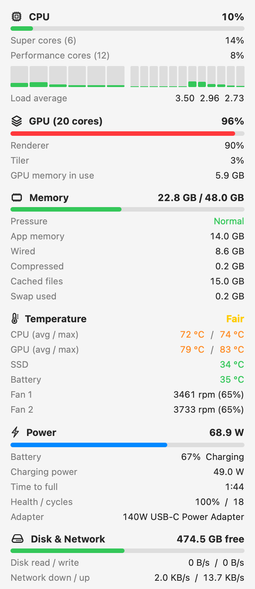

# MacStats

A small menu bar app for Apple Silicon Macs. It shows CPU, GPU, memory, temperature, fan, power, disk and network values. It does not need root access.

The menu bar shows `CPU 12%  GPU 48%  72°`. Click it to open a panel with all values.

<p align="center">
  
</p>

## What it shows

| Group | Values | Source |
|---|---|---|
| CPU | Total usage, usage per core cluster, usage per core, load average | `host_processor_info`, device tree `cluster-type` |
| GPU | Device, renderer and tiler usage, GPU memory in use, core count | IOKit `IOAccelerator` → `PerformanceStatistics` |
| Memory | Used (app + wired + compressed), cached files, swap, memory pressure | `host_statistics64`, `vm.swapusage`, `kern.memorystatus_vm_pressure_level` |
| Temperature | CPU and GPU average and maximum, SSD, battery, macOS thermal state | SMC keys `Tp*` and `Tg*`, HID sensors `NAND` and `gas gauge battery`, `ProcessInfo.thermalState` |
| Fans | Speed in rpm and percent of maximum | SMC keys `FNum`, `F<n>Ac`, `F<n>Mx` |
| Power | Total system power, battery charge and state, charge or drain power, time remaining, health, cycle count, adapter | IOKit `AppleSmartBattery` |
| Disk | Free space of the startup volume, read and write speed | `URLResourceValues`, IOKit `IOBlockStorageDriver` |
| Network | Download and upload speed (all interfaces except loopback) | `sysctl` `NET_RT_IFLIST2` |

## Limits

- Apple does not document the SMC temperature keys or the HID sensor names. The app uses the `Tp` (CPU) and `Tg` (GPU) prefixes, which open source monitors also use. A different chip can use different keys. If a value is not found, the panel shows `–`.
- CPU and GPU power in watts and CPU frequency are not shown. They need `powermetrics` (root) or the private IOReport API.
- Tested on an Apple M5 Pro with macOS 27.2.

## Requirements

- Apple Silicon Mac, macOS 14 or later
- Xcode command line tools (Swift 6)

## Build and run

1. Build the app bundle:

   ```sh
   make app
   ```

2. Start the app:

   ```sh
   open build/MacStats.app
   ```

3. Optional: copy the app to `/Applications`:

   ```sh
   make install
   ```

The app starts only when you open it. It does not start at login. To start it at login, add it in System Settings → General → Login Items.

To quit the app, open the panel and click **Quit**.

After a code change, run `make app` again to rebuild the bundle.

## Command-line probe

`statsprobe` prints the same values in the terminal. Use it to check the sensors on a new Mac.

```sh
swift run statsprobe          # one snapshot
swift run statsprobe --raw    # all HID temperature sensors and SMC fan/temperature keys
```

## Project layout

```
Sources/
  CSensors/    C code for the private HID temperature API and the AppleSMC interface
  StatsKit/    One sampler per value group, and SystemSampler that collects a Snapshot
  MacStats/    Menu bar app (AppKit entry point and status item, SwiftUI panel)
  statsprobe/  Command-line probe
scripts/bundle.sh   Builds build/MacStats.app (ad-hoc signed)
```

## Performance

The app samples all values every 2 seconds. One sample takes about 1.6 ms of CPU time. Most of the wall time is spent waiting for the SMC.

The largest cost is the menu bar redraw when the title changes. To keep it low, the title has a fixed width, it uses digits of equal width, and it updates only when the text changes. The panel view exists only while the panel is open. The app uses a plain AppKit entry point, not the SwiftUI App lifecycle.

Measured on an M5 Pro with the panel closed, over 60 seconds:

| Resource | Use |
|---|---|
| CPU | 0.5–0.8% of one core |
| Memory | 26 MB physical footprint |
| GPU | No GPU work of its own. macOS draws the menu bar item. |
